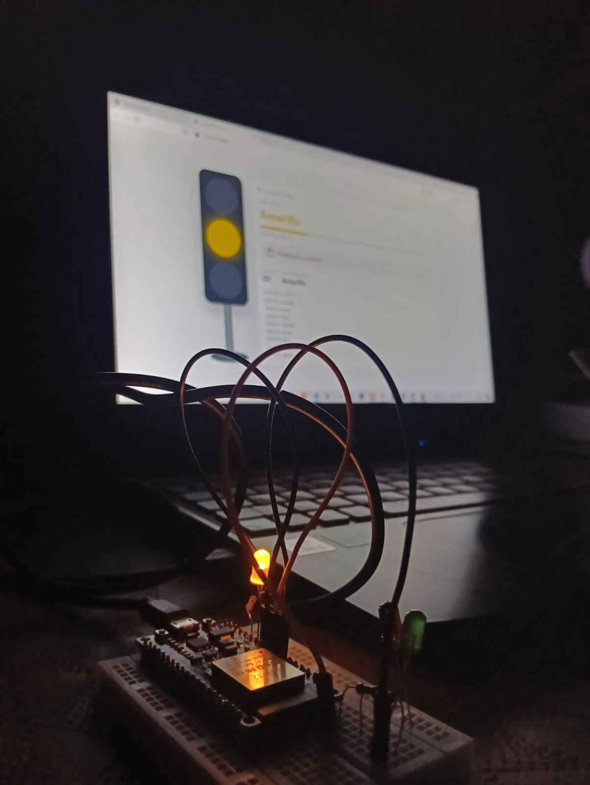
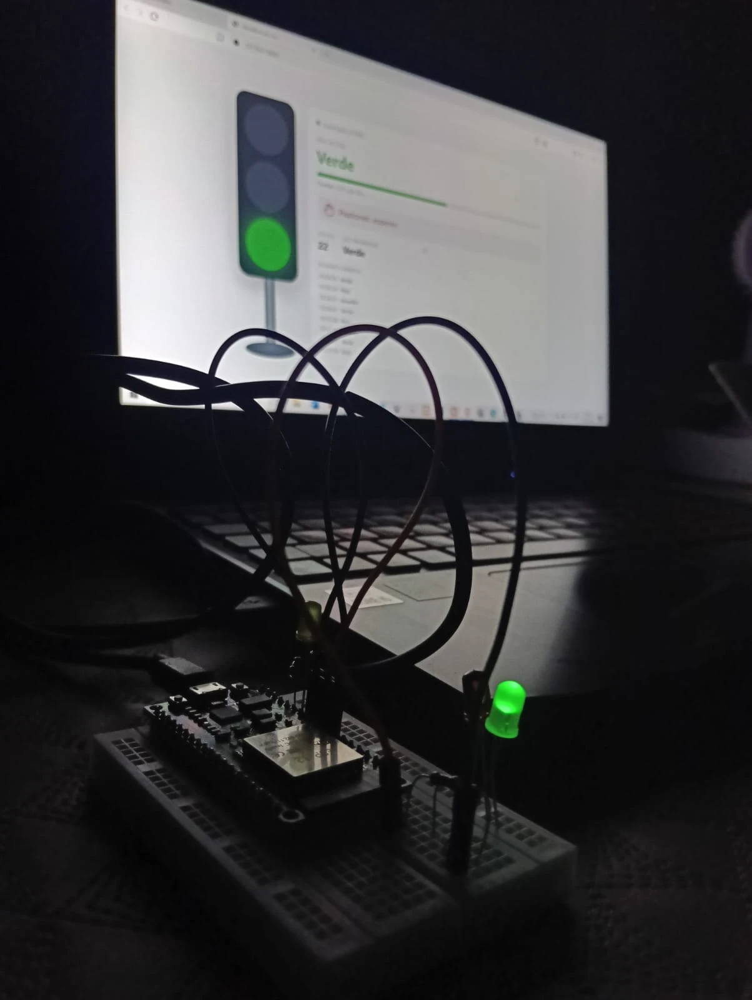

# Semáforo con ESP32 y dashboard en tiempo real

Semáforo vehicular con LEDs rojo, amarillo y verde controlado por un ESP32,
con aviso sonoro para peatones y un dashboard web que muestra en vivo qué
luz está encendida.

<p align="center">
  
  &nbsp;
  
</p>
<p align="center"><em>El LED del protoboard y el dashboard de la laptop cambian al mismo tiempo.</em></p>

## Funcionamiento

| Fase | Duración | Peatones | Buzzer |
|---|---|---|---|
| Verde | 30 s (parpadea 5 veces al final) | Esperan | Silencio |
| Amarillo | 3 s | Esperan | Silencio |
| Rojo | 25 s | Cruzan | Bip lento; bip rápido los últimos 5 s |

Los tiempos se cambian al inicio de [`src/main.cpp`](src/main.cpp).

## Materiales

- ESP32 DevKit de 38 pines
- 3 LEDs (rojo, amarillo, verde) y 3 resistencias de 220 Ω
- Buzzer activo de 3–5 V (opcional)
- Protoboard y cables jumper

## Conexiones

Las patas cortas (−) de todos los LEDs y el negativo del buzzer van a GND.

| Componente | Pin del ESP32 |
|---|---|
| LED rojo (con resistencia) | GPIO 26 |
| LED amarillo (con resistencia) | GPIO 13 |
| LED verde (con resistencia) | GPIO 27 |
| Buzzer (+) | GPIO 25 |

## Subir el programa al ESP32

Proyecto de [PlatformIO](https://platformio.org/). Abre la carpeta en VS Code
con la extensión de PlatformIO y pulsa **Upload** (→), o desde la terminal:

```
pio run -t upload
```

El puerto está fijado en `COM3` en [`platformio.ini`](platformio.ini); cámbialo
si tu ESP32 usa otro.

## Dashboard

El ESP32 envía por USB (Serial, 115200 baudios) un mensaje en cada cambio:

- `FASE,<nombre>,<segundos>`: empieza una fase y cuánto dura
- `LUZ,<color>`: qué LED está encendido (`APAGADO` durante el parpadeo)

[`dashboard/servidor.py`](dashboard/servidor.py) lee esos mensajes y los
muestra en una página web. En Windows basta con abrir
[`dashboard/INICIAR_DASHBOARD.bat`](dashboard/INICIAR_DASHBOARD.bat): prepara
Python la primera vez y abre http://127.0.0.1:8001.

Mientras el dashboard está abierto ocupa el puerto serie, así que hay que
cerrarlo antes de subir un programa nuevo al ESP32.

## Otros archivos

- [`PRUEBA_BUZZER/`](PRUEBA_BUZZER): sketch de Arduino para probar solo el buzzer.
